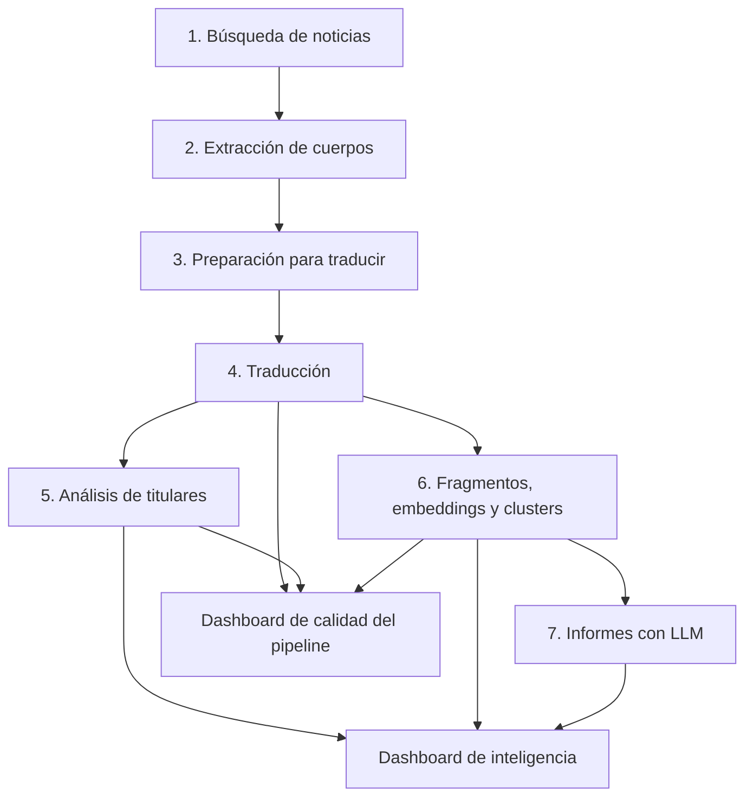

# GlobalPulse NLP

**Inteligencia narrativa multilingüe para explorar cómo distintos medios presentan un mismo acontecimiento.**

GlobalPulse reúne noticias, extrae y traduce sus textos, analiza sus titulares y agrupa fragmentos de los cuerpos por similitud semántica. Los resultados se consultan en dos dashboards de Streamlit: uno para controlar la calidad del proceso y otro para investigar patrones de cobertura y narrativas mediáticas.

El proyecto parte de una idea: **la narrativa es el centro del análisis mediático**. Además de identificar de qué hablan las noticias, busca explorar cómo se encuadran los acontecimientos, qué actores aparecen, qué roles reciben y qué interpretaciones compiten.

## Qué permite hacer

- Comparar encuadres y tonos de titulares entre medios.
- Explorar cómo se representa a los actores en los titulares.
- Identificar temas compartidos y diferencias de cobertura en el corpus.
- Navegar por fragmentos, clusters y sus relaciones semánticas.
- Consultar narrativas, citas y hallazgos de informes generados sobre lotes de fragmentos.
- Auditar extracción, traducción, análisis, embeddings e integridad de los archivos.

## Pipeline



El dashboard de calidad también inspecciona los archivos de búsqueda, extracción y preparación de traducciones.

| Paso | Componente | Función | Salidas |
|---|---|---|---|
| 1 | `url_search.py` | Recuperar titulares, enlaces y fuentes de noticias | `urls.csv` |
| 2 | `text_extraction.py` | Extraer cuerpos y registrar el estado y método de extracción | `texts.csv` |
| 3 | `clean_df_to_translate.py` | Preparar las tablas de títulos y cuerpos para traducir | `titles_to_translate.csv`, `texts_to_translate.csv` |
| 4 | `translate_text.py` | Producir las versiones en inglés para el análisis | `gold_titles.csv`, `gold_texts.csv` |
| 5 | `title_analysis` | Analizar encuadre y tono; identificar actores y roles en titulares | `test_titles.csv`, `final_test.csv` |
| 6 | `text_analysis` | Dividir cuerpos en fragmentos, calcular embeddings y formar clusters | `fragments_test.csv`, archivo de embeddings, `clusters_test.csv`, `clusters.txt` |
| 7 | `llm_call.py` | Analizar lotes de fragmentos y generar informes | `cluster_analysis/cluster_N_part_M.md`, `globalpulse_report.txt` |
| 8 | `dashboard_pipeline.py` | Auditar calidad, cobertura e integridad | Dashboard y tablas descargables |
| 9 | `dashboard_intelligence.py` | Explorar resultados de inteligencia mediática | Dashboard, redes y tablas descargables |

`title_analysis` y `text_analysis` son los nombres de los componentes del proyecto; utiliza sus nombres de archivo reales al ejecutarlos. En la planificación, el dashboard de inteligencia también se ha denominado `media_intelligence.py`; el script entregado y los comandos de este README usan `dashboard_intelligence.py`.

La red de nodos se calcula dentro del dashboard a partir de los resultados existentes. No necesita un script previo de graficación.

## Datos y trazabilidad

Los archivos conservan las columnas del pipeline. Los dashboards añaden recuentos y proporciones derivados, sin generar etiquetas narrativas nuevas a partir de esos cálculos.

| Archivo | Columnas utilizadas o esperadas |
|---|---|
| `urls.csv` | `title`, `url`, `source`, `language` |
| `titles_to_translate.csv` | `language`, `title`, `article_id` |
| `texts_to_translate.csv` | `title`, `language`, `body`, `article_id` |
| `texts.csv` | `title`, `url`, `source`, `language`, `body`, `extraction_status`, `extraction_method`, `article_id` |
| `gold_titles.csv` | `title`, `article_id`, `language`, `title_en` |
| `gold_texts.csv` | `body`, `article_id`, `title`, `language`, `body_en`, `title_en` |
| `test_titles.csv` | `language`, `title`, `article_id`, `title_en`, `frame_analysis`, `tone` |
| `final_test.csv` | `title`, `article_id`, `language`, `title_en`, `actor`, `actor_role`; puede contener también `frame_analysis` y `tone`, que no se usan como fuente del análisis de encuadres |
| `fragments_test.csv` | `article_id`, `fragment_id`, `fragment` |
| Archivo de embeddings | `article_id`, `fragment_id`, `fragment`, `embedding` |
| `clusters_test.csv` | `article_id`, `fragment_id`, `fragment`, `embedding`, `cluster`, `cluster_probability` |

Las columnas de índice exportadas como `Unnamed: ...` se ignoran al cargar los CSV.

### Convenciones importantes

- **`article_id`** conecta un artículo entre las distintas etapas. Se lee como texto.
- **`article_id` + `fragment_id`** identifica un fragmento para los cruces. No se presupone que `fragment_id` sea globalmente único.
- `urls.csv` no tiene `article_id`: su correspondencia con `texts.csv` se comprueba mediante URL exacta.
- Los totales de **titulares disponibles** y **artículos disponibles** corresponden a filas de `gold_titles.csv` y `gold_texts.csv`, respectivamente. Son distintos de los recuentos de IDs únicos.
- **Encuadres y tonos proceden de `test_titles.csv`. Actores y roles proceden de `final_test.csv`. Ambos análisis corresponden a titulares.**
- Los recuentos de titulares conservan las filas con IDs repetidos. Los metadatos contradictorios y ciertos cruces se controlan por separado para evitar multiplicar registros.
- El dashboard espera el nombre **`embbedings_test.csv`**, tal como está implementado. Si la salida local se llama `embedings_test.csv`, unifica el nombre antes de cargarla. La red también puede usar los embeddings de `clusters_test.csv`.
- Los vectores se admiten como listas con comas o como representaciones NumPy con espacios y saltos de línea. Deben guardarse completos: los vectores con `...` no pueden reconstruirse.

Los archivos de una sesión de análisis deben corresponder al mismo corpus y ejecución. La compatibilidad de dimensión de los embeddings no garantiza que procedan del mismo modelo.

## Dashboard de calidad del pipeline

`dashboard_pipeline.py` permite cargar CSV desde una carpeta o mediante subida de archivos, configurar el separador y la codificación y descargar tablas de revisión.

| Pestaña | Qué muestra |
|---|---|
| **Resumen y etapas** | Totales de titulares y artículos, URLs, fuentes, fragmentos y cobertura de artículos únicos por etapa |
| **Extracción** | Estados, métodos finales, cuerpos vacíos o cortos, longitudes y registros para revisar |
| **Traducción** | Presencia de títulos y cuerpos en inglés, correspondencias con las colas de traducción y comparación de longitudes |
| **Fragmentos y clusters** | Fragmentación, repeticiones, tamaños de clusters, ruido, pertenencia y validación opcional de vectores |
| **Integridad y datos** | Inventario, columnas ausentes, claves vacías o duplicadas y correspondencias entre archivos |
| **Análisis de titulares** | Campos de encuadre, tono, actor y rol presentes; distribuciones completas y cobertura respecto a los IDs de `gold_titles.csv` |

Los estados que significan extracción exitosa se seleccionan en la barra lateral. La longitud mínima y el umbral de pertenencia débil son criterios de revisión configurables.

El método final registrado no permite reconstruir todos los intentos anteriores del extractor. La presencia de una traducción tampoco mide su fidelidad.

## Dashboard de inteligencia mediática

`dashboard_intelligence.py` conecta resultados cuantitativos de titulares, agrupaciones temáticas de los cuerpos e informes cualitativos.

| Pestaña | Qué aporta |
|---|---|
| **Encuadres y medios** | Distribución de encuadres y tonos, comparación entre fuentes y relación tono × encuadre |
| **Actores y roles** | Ranking acumulado del 80 %, frecuencias completas, matriz actor × rol, diversidad de roles y evidencia textual |
| **Cobertura temática** | Artículos y medios por cluster, concentración, amplitud temática y coincidencia de agendas entre medios |
| **Explorar evidencia** | Consulta de fragmentos por cluster y búsqueda literal |
| **Informes** | Lectura de originales por cluster y parte y del informe general |
| **Alcance y límites** | Procedencia de las métricas, disponibilidad de datos y restricciones interpretativas |
| **Idiomas** | Distribución de artículos por idioma y matrices de idioma con encuadre, tono y rol |
| **Red de clusters** | Conexiones por similitud coseno entre centroides de embeddings normalizados |
| **Red de actores y roles** | Red de asociaciones registradas en titulares, con enlaces ponderados por frecuencia |
| **Inteligencia narrativa** | Exploración por secciones de temas, subtemas, narrativas, citas y hallazgos de los informes existentes |

### Interacción y significado de las métricas

- Filtros globales por medio e idioma para las vistas de datos. Los indicadores superiores de disponibilidad mantienen los totales completos.
- Matrices entre variables distintas con recuentos, porcentajes por fila o columna y selección de valores en ambos ejes. Ocultar categorías no recalcula los denominadores.
- La cobertura temática incluye una opción de porcentaje de artículos del medio con fragmentos. Un artículo puede pertenecer a varios temas, por lo que esos porcentajes no tienen que sumar 100 %.
- La similitud entre agendas de medios usa Jaccard sobre conjuntos de clusters presentes. Es coincidencia temática, no equivalencia ideológica o narrativa.
- El conjunto del **80 % de actores** incluye el actor que cruza el umbral y todos los empatados con él. Es un filtro de presentación, no una validación de las entidades.
- La normalización opcional agrupa variantes explícitas de `United States`. Los nombres ambiguos y las etiquetas compuestas no se corrigen automáticamente.
- En la red de clusters, el tamaño refleja artículos únicos y el grosor del enlace refleja similitud semántica. Se excluye el ruido `-1`. La disposición circular no representa distancias semánticas.
- Los informes no se filtran automáticamente por medio o idioma. La pestaña narrativa organiza su contenido sin nuevas llamadas al LLM.

## Informes de los cuerpos

La carpeta `cluster_analysis` contiene informes por cluster divididos en lotes de hasta 12 fragmentos, además del informe general cuando se guarda allí.

Los nombres de los análisis siguen este patrón:

```text
cluster_0_part_1.md
cluster_0_part_2.md
cluster_1_part_1.md
globalpulse_report.txt
```

El ejemplo revisado contiene **Tema principal**, **Subtemas**, **Citas importantes**, **Hallazgos periodísticos** y **Narrativa identificada**. El explorador reconoce encabezados y conserva las secciones desconocidas como otras secciones; no inventa contenido si falta una sección.

Cada resultado mantiene su archivo, cluster y parte de procedencia. Las referencias numéricas a fragmentos se muestran como texto hasta verificar su correspondencia con `fragment_id`. Una conclusión sobre un lote no se convierte automáticamente en una conclusión sobre todo el cluster.

## Instalación y ejecución de los dashboards

Se necesita Python y un entorno con estas dependencias:

```bash
python -m pip install streamlit pandas numpy plotly
```

Estas son las dependencias de los dashboards, **no la lista completa del pipeline**. La búsqueda, extracción, traducción, embeddings y generación de informes requieren sus propias dependencias y configuración de servicios.

Ejemplo en Windows, creando un entorno dedicado sin necesidad de activarlo:

```powershell
python -m venv .venv
.\.venv\Scripts\python.exe -m pip install streamlit pandas numpy plotly
.\.venv\Scripts\python.exe -m streamlit run dashboard_pipeline.py
```

Para abrir el dashboard de inteligencia en otra terminal:

```powershell
.\.venv\Scripts\python.exe -m streamlit run dashboard_intelligence.py
```

Con el entorno ya activado, los comandos equivalentes son:

```bash
python -m streamlit run dashboard_pipeline.py
python -m streamlit run dashboard_intelligence.py
```

### Flujo de uso

1. Ejecutar las etapas del pipeline en orden, con las consultas y configuración deseadas.
2. Mantener juntos los CSV correspondientes a esa ejecución.
3. Generar los informes de los cuerpos y conservarlos en `cluster_analysis`.
4. Abrir el dashboard de calidad y seleccionar la carpeta de CSV o subir los archivos.
5. Revisar faltantes, extracción, traducción, identificadores y cobertura del análisis.
6. Abrir el dashboard de inteligencia y seleccionar las carpetas de CSV e informes, o subir los archivos.
7. Explorar patrones y consultar los titulares, fragmentos o informes que los sustentan.

Los dashboards leen resultados existentes: **no ejecutan el pipeline completo ni llaman al LLM**. La ejecución de los scripts previos debe configurarse en esos componentes. No se incluye aquí un comando de ejecución completa porque todavía no se ha definido un orquestador común.

El dashboard de inteligencia permite cambiar la ruta local desde la interfaz; su ruta predeterminada de desarrollo debe ajustarse a la máquina donde se ejecute.

## Alcance y limitaciones

GlobalPulse es una herramienta exploratoria de apoyo a la investigación periodística. Sus métricas describen **el corpus recuperado**, no toda la producción de un medio ni la opinión pública.

- **Tema, encuadre, tono y narrativa son dimensiones distintas.** Los clusters agrupan contenido semánticamente relacionado; sus etiquetas no son narrativas por sí mismas.
- La clasificación de titulares y los informes generados pueden contener errores. Su presentación en un gráfico no demuestra precisión.
- Las citas y atribuciones de los informes deben contrastarse con los fragmentos antes de usarlas como evidencia periodística.
- El volumen de fragmentos depende de la longitud y segmentación de los artículos; no equivale al número de noticias o fuentes independientes.
- La traducción puede alterar matices. El texto original se conserva como referencia.
- La frecuencia de actores no determina su validez, y el tono general del titular no equivale necesariamente a sentimiento hacia el actor.
- La ausencia de un tema en una fuente dentro del corpus no demuestra omisión deliberada.
- No se calculan evolución temporal, impacto de audiencia, país del medio ni intencionalidad editorial a partir de las columnas actuales.
- No se calculan cuotas de narrativas de los cuerpos contando menciones en informes cualitativos.
- No se registra de forma completa tiempo, consumo de tokens, coste o identificación de ejecución en los esquemas actuales.

## Validación y siguientes pasos

Se han realizado comprobaciones de lógica con datos sintéticos, archivos ausentes y formatos de embeddings. También se verificó la lectura del CSV de clusters y la separación de secciones de un informe de ejemplo. Esto **no constituye una evaluación de precisión de los modelos ni una validación completa del pipeline**.

Las prioridades para consolidar la versión son:

1. Evaluar manualmente una muestra de encuadres, tonos, actores y roles.
2. Revisar la coherencia de los clusters y el respaldo textual de los informes.
3. Verificar las referencias entre informes, fragmentos y artículos.
4. Documentar modelos, parámetros, prompts y versiones utilizados en cada ejecución.
5. Consolidar nombres de archivos y un archivo de dependencias reproducible.

## Publicación del repositorio

Antes de subir el proyecto a GitHub, mantener fuera del repositorio las claves de API, los entornos virtuales y la configuración privada. Publicar un corpus de ejemplo o resultados derivados solo cuando se disponga de los permisos necesarios para compartirlos.

La licencia del código debe elegirse y añadirse en un archivo `LICENSE`; este README no concede una licencia sobre el código ni sobre los textos periodísticos.
